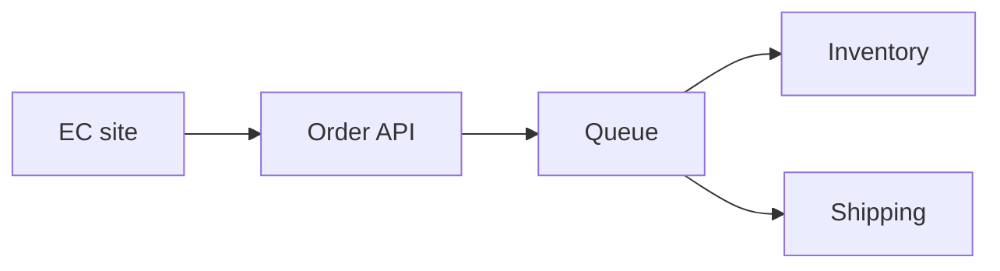

# ルミナ茶EC受注連携

## 出席者
相手（ほしぞら食品）、自分

## 議題
### 1. 現状の取り込み
毎朝CSVを手作業で取り込んでおり、取り込み漏れが出やすい。 [[#^t00-00-15|00:15]]

### 2. 連携の構成
受注APIを中心に在庫管理と出荷システムへ流す構成で合意した。 [[#^t00-00-40|00:40]]

### 3. 日程
年末セールに向けて十二月十日までに結合テストを終える。 [[#^t00-01-15|01:15]]

### 4. 負荷対策
注文の集中に備えてキューで順に処理する案が出た。 [[#^t00-03-05|03:05]]

## 要約
ルミナ茶のEC受注を倉庫システムへ自動でつなぐ構成を相談した。今は毎朝CSVを手作業で取り込んでおり、取り込み漏れが課題になっている。

ECサイトから受注APIを経て在庫管理と出荷システムへ流す構成で進めることに決め、受注APIは自分の側で作る。

年末セールが十二月二十日に始まるため、十二月十日までに結合テストを終える前提で進める。

セール初日の注文集中で受注APIが詰まるおそれがあり、キューに積んで順に処理する案が出た。APIの認証方式と前回のトラブルの原因は持ち越しになった。

## 重要ポイント
- 注文データは毎朝CSVを手作業で取り込んでいる [[#^t00-00-15|00:15]]
- 年末セールは十二月二十日に始まる [[#^t00-01-15|01:15]]

## 決定事項
- ECサイトから受注API、在庫管理・出荷システムへ流す構成で進める [[#^t00-00-55|00:55]]

## アクション
| 優先度 | 内容 | 担当 | 期限 | 出典 |
|---|---|---|---|---|
| 高 | 出荷システムの仕様書を送る | 相手 | 来週月曜 | [[#^t00-02-30\|02:30]] |
| 高 | 受注APIの設計書を作る | 自分 | 今週金曜 | [[#^t00-02-40\|02:40]] |
| 中 | 受注APIを作る | 自分 | — | [[#^t00-00-55\|00:55]] |
| 低 | トラブルの原因を確認する | — | — | [[#^t00-04-00\|04:00]] |

## 質問
- [ ] APIの認証方式はどうするか — 相手 [[#^t00-01-50|01:50]]
  → APIキー方式で検討中で、まだ決めていない
- [x] 出荷システムの仕様書はいつ届くか — 自分 [[#^t00-02-10|02:10]]
  → 来週月曜までに届く
- [ ] 前回のトラブルの原因は分かったか [[#^t00-03-40|03:40]]

## 締め切り
- 年末セールの開始 — 12月20日 [[#^t00-01-15|01:15]]
- 結合テストの完了 — 12月10日（自分） [[#^t00-01-30|01:30]]

## フォローアップ
- APIの認証方式を決める [[#^t00-02-00|02:00]]
- 前回のトラブルの原因を次回の定例で確認する [[#^t00-04-00|04:00]]

## リスク
- 🔴 セール初日に注文が集中して受注APIが詰まる — 対策: 受注をキューに積んで順に処理する [[#^t00-03-05|03:05]]
- 🟠 CSVの手作業取り込みで漏れが出る [[#^t00-00-25|00:25]]

## インサイト
- 手作業の取り込みは漏れが出やすく、自動化の効果が大きい [[#^t00-00-25|00:25]]

## 構成図

## ブックマーク
- [[#^t00-03-05|03:06]] 負荷の話

## 文字起こし

**[00:00:03] 相手**: 本日はルミナ茶のEC受注を倉庫システムにつなぐ件でご相談です。 ^t00-00-03

**[00:00:08] 自分**: よろしくお願いします。 ^t00-00-08

**[00:00:15] 相手**: 現在は注文データを毎朝CSVで手作業で取り込んでいます。 ^t00-00-15

**[00:00:25] 自分**: 手作業だと取り込み漏れが出やすいですね。 ^t00-00-25

**[00:00:40] 相手**: ECサイトから受注APIに送り、そこから在庫管理と出荷システムに流す形を考えています。 ^t00-00-40

**[00:00:55] 自分**: その構成で進めましょう。受注APIはこちらで作ります。 ^t00-00-55

**[00:01:15] 相手**: 年末のセールは十二月二十日に始まるので、それまでに動かしたいです。 ^t00-01-15

**[00:01:30] 自分**: では十二月十日までに結合テストを終える前提で進めます。 ^t00-01-30

**[00:01:50] 相手**: APIの認証方式はどうされますか。 ^t00-01-50

**[00:02:00] 自分**: APIキー方式で考えていますが、まだ決めていません。 ^t00-02-00

**[00:02:10] 自分**: 仕様書はいつ頃いただけますか。 ^t00-02-10

**[00:02:30] 相手**: 出荷システムの仕様書は来週月曜までにお送りします。 ^t00-02-30

**[00:02:40] 自分**: 受け取ったら、私の方で受注APIの設計書を今週金曜までに作ります。 ^t00-02-40

**[00:03:05] 相手**: 一点心配なのは、セール初日に注文が集中して受注APIが詰まることです。 ^t00-03-05

**[00:03:20] 自分**: 受注はキューに積んで順に処理すれば、集中しても落ちにくいと思います。 ^t00-03-20

**[00:03:40] 自分**: 前回のトラブルの原因は分かりましたか。 ^t00-03-40

**[00:03:50] 相手**: まだ調査中です。 ^t00-03-50

**[00:04:00] 自分**: 原因は次回の定例で確認させてください。 ^t00-04-00

**[00:05:00] 相手**: 本日はありがとうございました。 ^t00-05-00

**[00:05:05] 自分**: 失礼します。 ^t00-05-05
