# AutoNote をはじめて使う — 最初の議事録ができるまで

AutoNote は、メニューバーに常駐して会議を録音し、止めると文字起こしと議事録を自動で作る Mac のアプリです。この手順書では、アプリを起動してから最初の議事録ができるまでを、実際の画面で順に説明します。

必要なもの:

- macOS 26 以降の Mac
- 議事録を作るための Claude Code（ターミナルで `claude` と打って使えて、ログインしている状態）

---

## 1. アプリを起動する

AutoNote を起動すると、初回はメインウィンドウが自動で開きます。メニューバーには波形のアイコンが出ます。2 回目以降の起動ではウィンドウは開かず、メニューバーのアイコンだけが出ます。

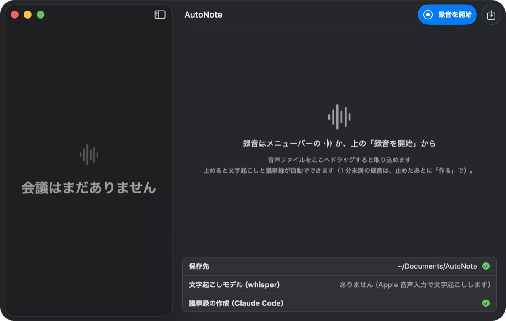

ウィンドウ下部の **準備カード** の 3 行を確かめます。

- **保存先**: 議事録を書き出すフォルダです。初回は「書類」フォルダの中に `AutoNote` フォルダが自動で作られ、ここが保存先になります。緑のチェックが付いていれば準備できています。
- **文字起こしモデル（whisper）**: 初回の起動で、高精度な文字起こし用のモデルが裏で自動ダウンロードされます。終わるまでの間（画像のようにモデルが無い間も）、文字起こしは Apple 音声入力で行うので、すぐに録音を始めてかまいません。
- **議事録の作成（Claude Code）**: Claude Code が見つかると緑のチェックが付きます。見つからないときは次の「2.」へ進んでください。

「書類」フォルダへのアクセスを許可するか尋ねるダイアログが出たら、**許可** を押してください。許可しないと議事録を保存できません。

## 2. Claude Code が見つからないとき

議事録の作成には Claude Code が要ります。見つからないと、準備カードの 3 行目が「見つかりません」になり、ボタンが 2 つ出ます。

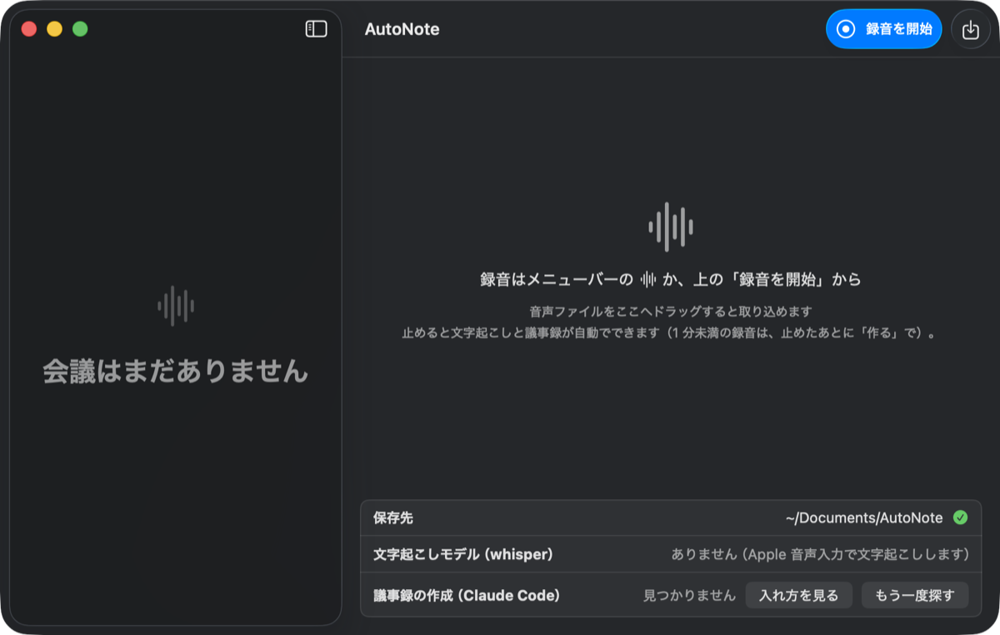

1. **入れ方を見る** を押すと、Claude Code の公式のインストール手順が開きます。手順に沿って入れ、ターミナルで `claude` を一度起動してログインします。
2. AutoNote に戻り、**もう一度探す** を押します。行に緑のチェックが付けば準備完了です。

メニューバーのアイコンを押したメニューにも「⚠ 議事録の作成に Claude Code が要ります…」が出ます。ここを押しても同じ案内に進めます。

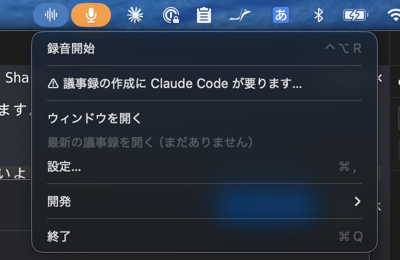

Claude Code が無くても録音と文字起こしはできます。議事録は、Claude Code を入れたあとに作り直せます（「8.」を参照）。

## 3. 録音を始める（3 つの方法）

録音の開始方法は 3 つあり、どれでも同じように録音が始まります。

- **ウィンドウの「録音を開始」**: メインウィンドウ右上の青いボタンを押します（「1.」の画像の右上）。
- **メニューバーのメニュー**: メニューバーの波形アイコンを押し、**録音開始** を選びます。
- **キーボード**: どのアプリを使っていても **⌃⌥R**（control + option + R）で始まります。

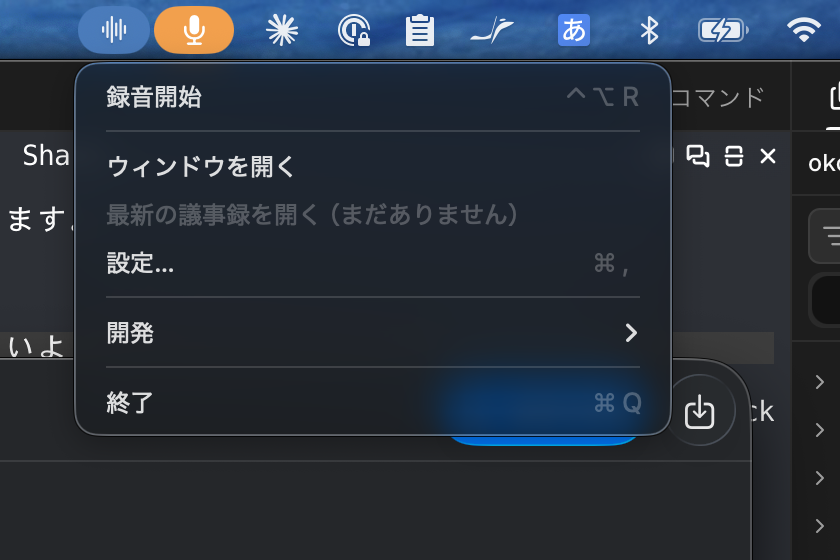

はじめて録音するときは、マイクの使用を許可するか尋ねるダイアログが出ます。**許可** を押してください。許可しないと音声を録れません。

## 4. 録音中の画面

録音が始まると、ウィンドウの上に赤い帯が出て、録音中であることと音を拾えているかがわかります。話した内容は、その場で下に文字になって流れていきます。

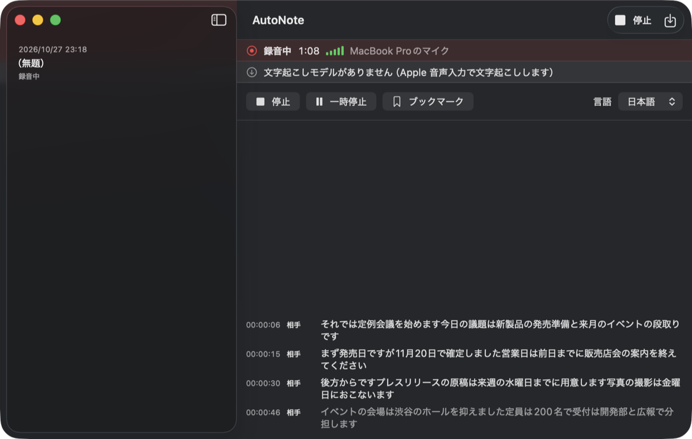

- **録音中 1:08**: 経過時間です。
- **緑のバー**: 入力レベルです。話すとバーが伸びます。しばらく伸びないときは、マイクが音を拾えていません。
- **MacBook Pro のマイク**: 録音に使っているマイクです。
- **停止 / 一時停止 / ブックマーク**: 録音を止める、一時的に止める、いまの時刻に印を付ける、のボタンです。
- まだ誰も話していないときは、画面の中央に「聞き取り中…」と出ます。

録音中はメニューバーのアイコンが経過時間の表示に変わります。メニューからも停止や一時停止ができ、⌃⌥R で停止、⌃⌥P で一時停止・再開もできます。

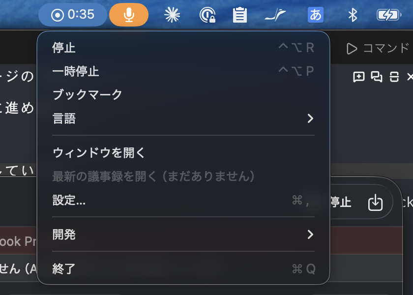

**一時停止** を押すと、帯が「一時停止中」になり、ボタンが **再開** に変わります。再開すると同じ録音の続きになります。

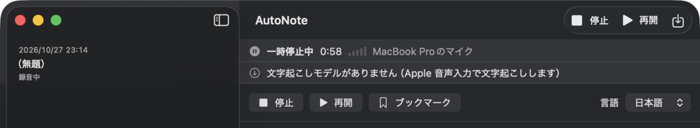

## 5. 録音を止める → 処理が進む

**停止**（ツールバー、帯の下のボタン、メニュー、⌃⌥R のどれでも）を押すと、録音が保存され、文字起こしと議事録づくりが自動で始まります。何も押さずに待つだけです。

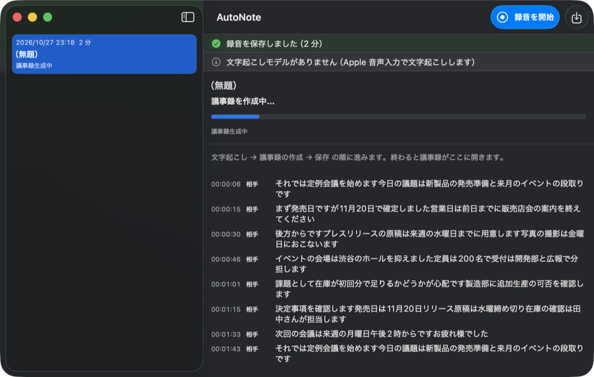

- 緑の帯「録音を保存しました（2 分）」が数秒出ます。
- 右側の見出しが、進み具合に合わせて「文字起こし中…」→「議事録を作成中…」と変わります。
- 左の一覧では、この会議の状態が「議事録生成中」になります。

2 分ほどの会議なら、数十秒〜数分で終わります。ウィンドウを閉じて別の作業をしていてもかまいません。

## 6. 議事録ができた

処理が終わると、ウィンドウを開いたまま待っていた場合は、その場に議事録が開きます。上の緑の帯に、保存したファイルの場所が出ます。

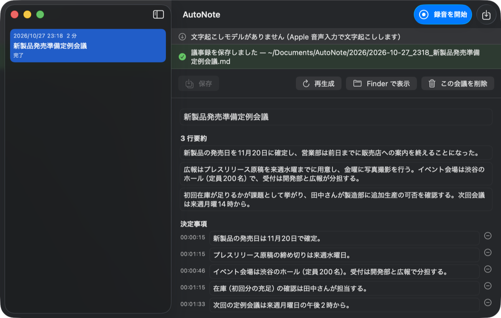

- 会議名は内容から自動で付きます（一覧の「(無題)」が置き換わります）。
- 本文には **3 行要約**、**決定事項**、**議題** などが並びます。下へスクロールすると続きが読めます。
- **Finder で表示** を押すと、保存された議事録ファイル（Markdown 形式）が Finder で選ばれた状態で開きます。ファイルには要約・決定事項・議題のほか、Next Action、ブックマーク、文字起こしの全文も入っています。
- ウィンドウを閉じていた場合は、通知「議事録ができました」が 1 通届きます。通知を押すと、この画面が開きます。メニューバーのメニューの **最新の議事録を開く** からも開けます。

これで最初の議事録の完成です。

---

## 7. 1 分未満で止めたとき

録音が 1 分未満だと、自動では文字起こしも議事録づくりもしません。試しに録っただけの短い録音で、議事録が勝手に増えないようにするためです。

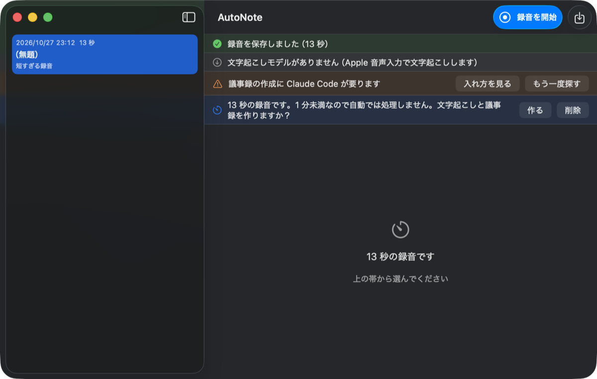

- 議事録がほしいときは **作る** を押します。そこから「5.」と同じ流れで処理が進みます。
- 要らなければ **削除** を押します。

## 8. うまくいかないとき

うまくいかなかったときは、右側の赤い帯に「何が起きたか — なぜか」と、次に押すボタンが出ます。左の一覧では、その会議の状態が「失敗」などになります。

### 音声を聞き取れませんでした

録音に声が入っていなかったか、マイクが音を拾えていなかったときに出ます。

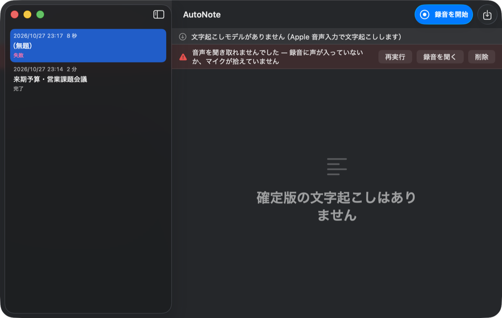

- **録音を聞く**: 録音した音声ファイルを Finder で表示します。再生して、声が入っているか確かめてください。
- **再実行**: もう一度文字起こしから処理します。文字起こしモデルのダウンロードが終わったあとなら、そちらで聞き取り直せます。
- **削除**: この録音を消します。

次の録音の前に、録音中の画面で緑のバーが話す声に合わせて伸びるか確かめてください。

### 議事録を作れませんでした — Claude Code が見つかりません

文字起こしはできたものの、Claude Code が見つからず議事録を作れなかったときに出ます。文字起こしの内容は帯の下に表示されていて、失われてはいません。

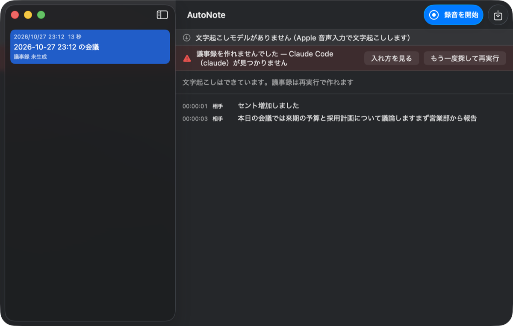

1. **入れ方を見る** を押し、手順に沿って Claude Code を入れてログインします（「2.」と同じです）。
2. **もう一度探して再実行** を押すと、Claude Code を探し直して議事録を作ります。

### 保存先が見つかりません

保存先のフォルダを消したり移動したりすると、準備カードの「保存先」の行がこの表示になります。

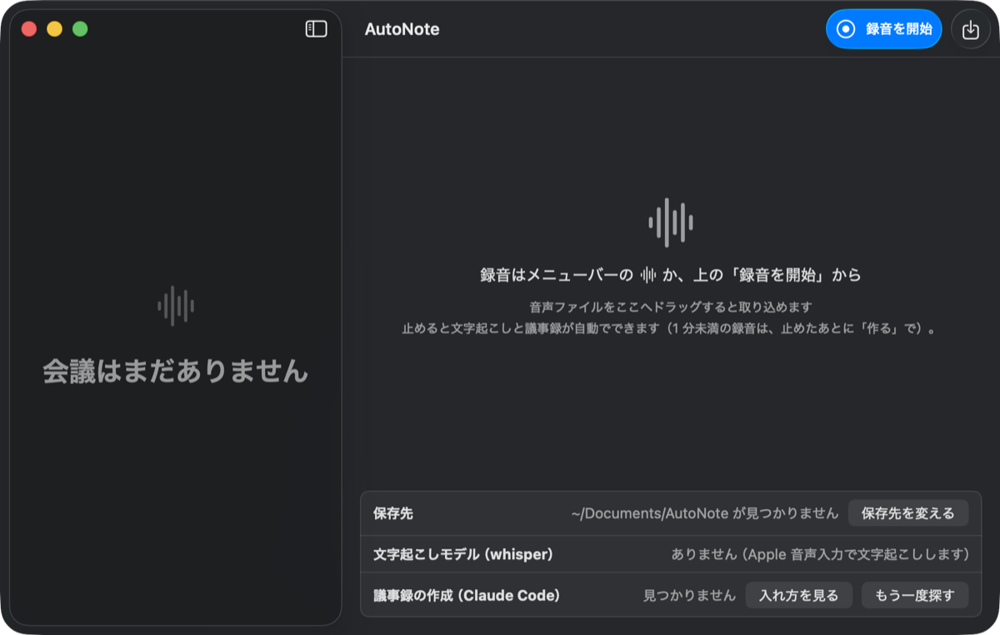

**保存先を変える** を押すと設定の「一般」タブが開くので、議事録を保存したいフォルダを選び直してください。
