# AutoNote をはじめて使う — 最初の議事録ができるまで

AutoNote は、メニューバーに常駐して会議を録音し、止めると文字起こしと議事録を自動で作る Mac のアプリです。この手順書では、アプリを起動してから最初の議事録ができるまでを、実際の画面で順に説明します。

必要なもの:

- macOS 26 以降の Mac
- 議事録を作るための Claude Code（ターミナルで `claude` と打って使えて、ログインしている状態）

---

## 1. アプリを起動する

AutoNote を起動すると、初回はメインウィンドウが自動で開きます。メニューバーには波形のアイコンが出ます。2 回目以降の起動ではウィンドウは開かず、メニューバーのアイコンだけが出ます。

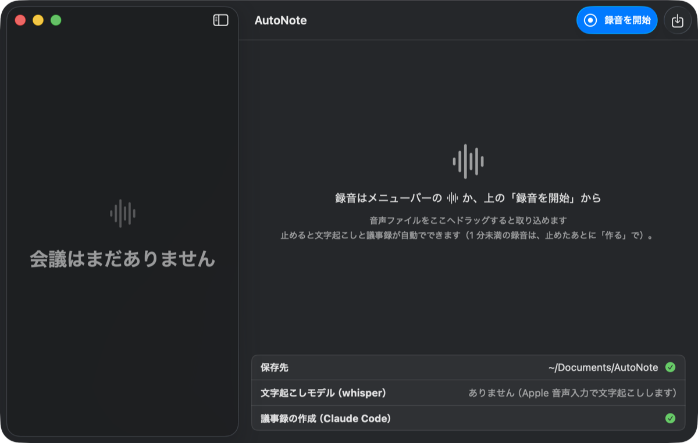

ウィンドウ下部の **準備カード** の 3 行を確かめます。

- **保存先**: 議事録を書き出すフォルダです。初回は「書類」フォルダの中に `AutoNote` フォルダが自動で作られ、ここが保存先になります。緑のチェックが付いていれば準備できています。
- **文字起こしモデル（whisper）**: 初回の起動で、高精度な文字起こし用のモデルが裏で自動ダウンロードされます。終わるまでの間（画像のようにモデルが無い間も）、文字起こしは Apple 音声入力で行うので、すぐに録音を始めてかまいません。
- **議事録の作成（Claude Code）**: Claude Code が見つかると緑のチェックが付きます。見つからないときは次の「2.」へ進んでください。

「書類」フォルダへのアクセスを許可するか尋ねるダイアログが出たら、**許可** を押してください。許可しないと議事録を保存できません。

## 2. Claude Code が見つからないとき

議事録の作成には Claude Code が要ります。見つからないと、準備カードの 3 行目が「見つかりません」になり、ボタンが 2 つ出ます。

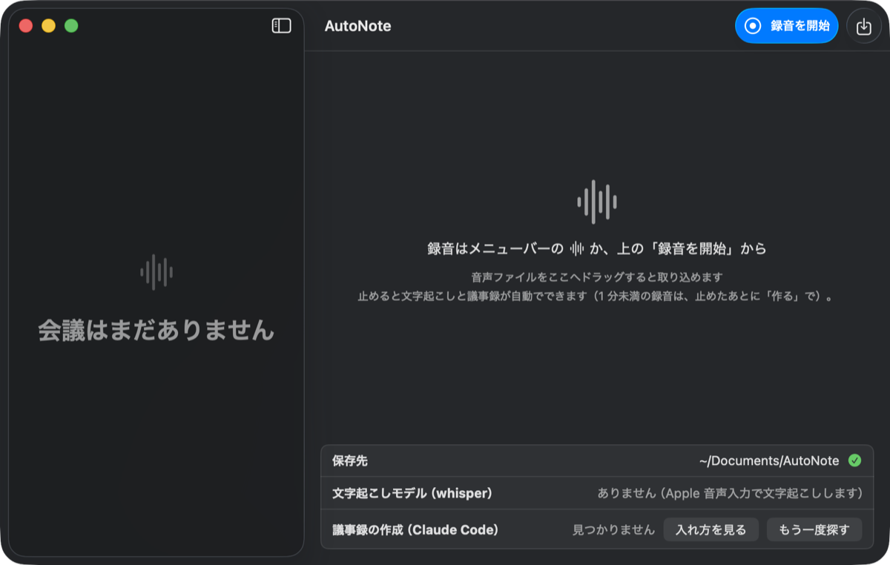

1. **入れ方を見る** を押すと、Claude Code の公式のインストール手順が開きます。手順に沿って入れ、ターミナルで `claude` を一度起動してログインします。
2. AutoNote に戻り、**もう一度探す** を押します。行に緑のチェックが付けば準備完了です。

メニューバーのアイコンを押したメニューにも「⚠ 議事録の作成に Claude Code が要ります…」が出ます。ここを押しても同じ案内に進めます。

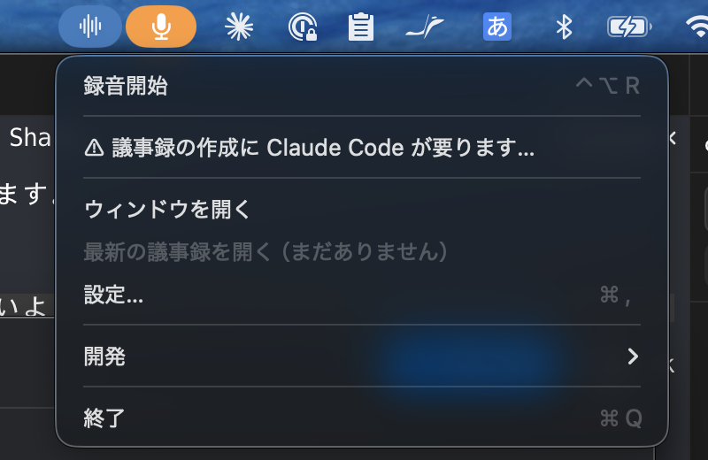

Claude Code が無くても録音と文字起こしはできます。議事録は、Claude Code を入れたあとに作り直せます（「8.」を参照）。

## 3. 録音を始める（3 つの方法）

録音の開始方法は 3 つあり、どれでも同じように録音が始まります。

- **ウィンドウの「録音を開始」**: メインウィンドウ右上の青いボタンを押します（「1.」の画像の右上）。
- **メニューバーのメニュー**: メニューバーの波形アイコンを押し、**録音開始** を選びます。
- **キーボード**: どのアプリを使っていても **⌃⌥R**（control + option + R）で始まります。

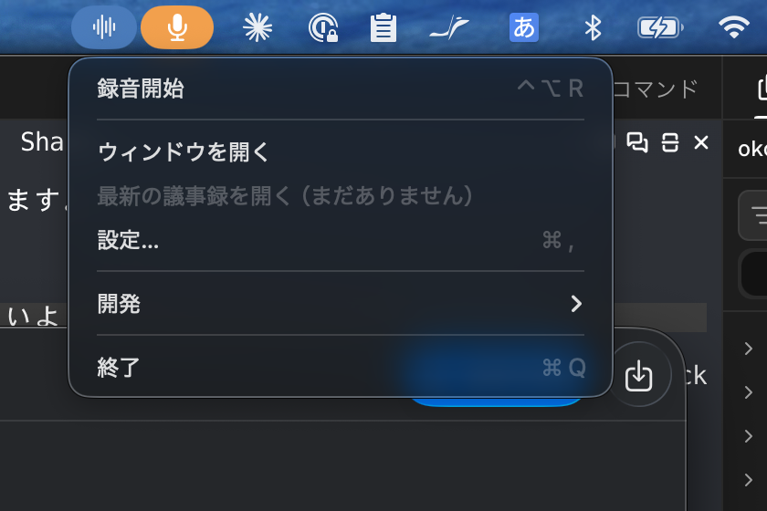

はじめて録音するときは、マイクの使用を許可するか尋ねるダイアログが出ます。**許可** を押してください。許可しないと音声を録れません。

## 4. 録音中の画面

録音が始まると、ウィンドウの上に赤い帯が出て、録音中であることと音を拾えているかがわかります。話した内容は、その場で下に文字になって流れていきます。

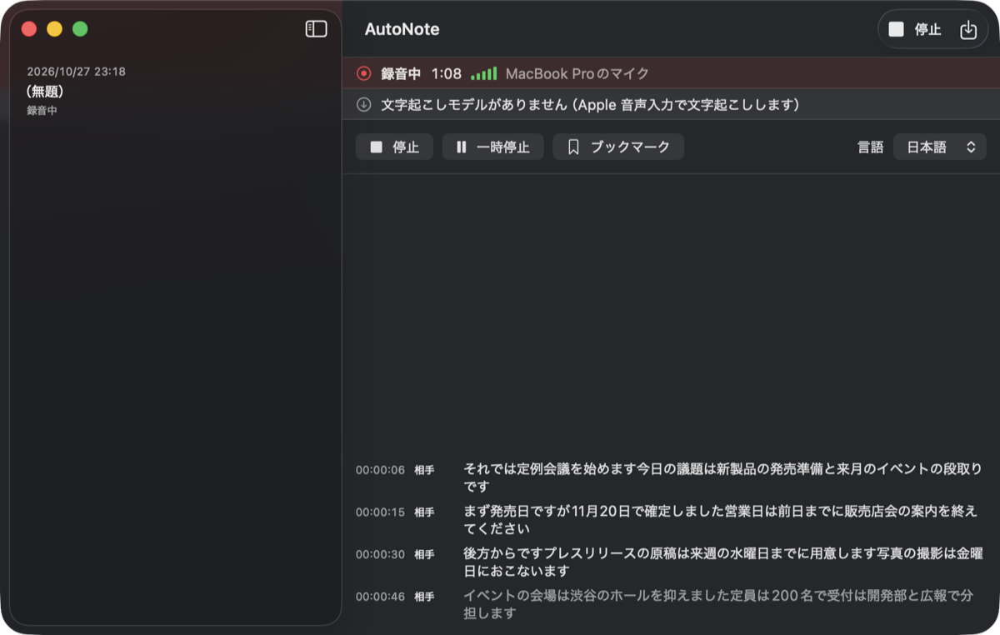

- **録音中 1:08**: 経過時間です。
- **緑のバー**: 入力レベルです。話すとバーが伸びます。しばらく伸びないときは、マイクが音を拾えていません。
- **MacBook Pro のマイク**: 録音に使っているマイクです。
- **停止 / 一時停止 / ブックマーク**: 録音を止める、一時的に止める、いまの時刻に印を付ける、のボタンです。
- まだ誰も話していないときは、画面の中央に「聞き取り中…」と出ます。

録音中はメニューバーのアイコンが経過時間の表示に変わります。メニューからも停止や一時停止ができ、⌃⌥R で停止、⌃⌥P で一時停止・再開もできます。

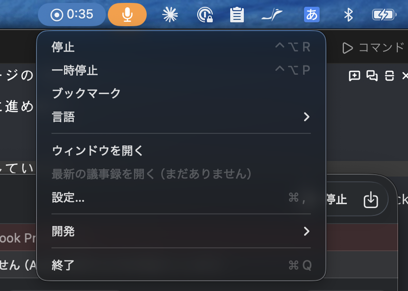

**一時停止** を押すと、帯が「一時停止中」になり、ボタンが **再開** に変わります。再開すると同じ録音の続きになります。

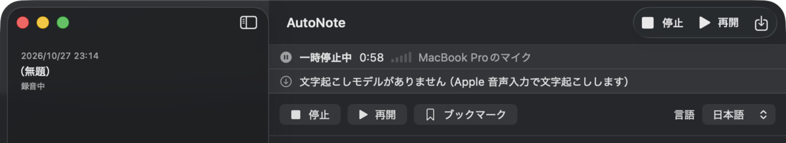

### リアルタイム要約（設定でオンにしたとき）

設定 → 一般 →「リアルタイム要約」で「録音中に要約を表示する」をオンにすると、録音中の画面の文字起こしの上に「いま」「決定事項」「宿題」のカードが出ます。カードは更新間隔（既定 20 秒）ごとに新しくなり、最後に更新してからの秒数が「n 秒前に更新」と出ます。

- 要約のために、確定した発話のテキストを Claude Code に送ります。議事録の作成と同じ Claude の利用枠を使います。音声は送りません。
- カードに「要約を休止中（Claude の利用制限）」と出たら、Claude の利用制限中か、議事録の作成が利用制限の明けを待っているあいだ、要約を休んでいます。制限が明ければ自動で戻ります。
- 要約が 3 回続けて失敗すると「要約を更新できません」と出ます。カードには前回までの内容が残ります。
- 録音を止めた後も、議事録ができるまで（処理中の画面や議事録が作れなかった画面で）カードは残ります。
- カード右上の ⌄ で折りたためます（› で広げます）。決定事項と宿題が多いときはその部分だけスクロールし、「n 秒前に更新」はいつも見えています。

## 5. 録音を止める → 処理が進む

**停止**（ツールバー、帯の下のボタン、メニュー、⌃⌥R のどれでも）を押すと、録音が保存され、文字起こしと議事録づくりが自動で始まります。何も押さずに待つだけです。

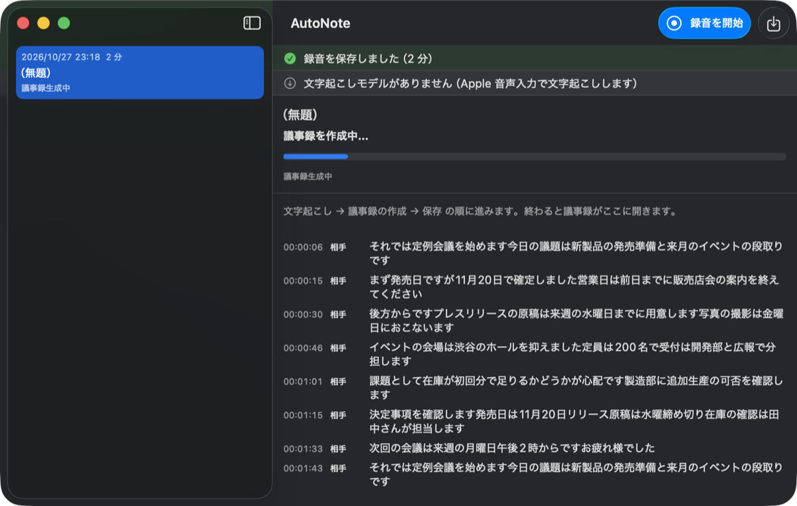

- 緑の帯「録音を保存しました（2 分）」が数秒出ます。
- 右側の見出しが、進み具合に合わせて「文字起こし中…」→「議事録を作成中…」と変わります。
- 左の一覧では、この会議の状態が「議事録生成中」になります。

2 分ほどの会議なら、数十秒〜数分で終わります。ウィンドウを閉じて別の作業をしていてもかまいません。

## 6. 議事録ができた

処理が終わると、ウィンドウを開いたまま待っていた場合は、その場に議事録が開きます。上の緑の帯に、保存したファイルの場所が出ます。

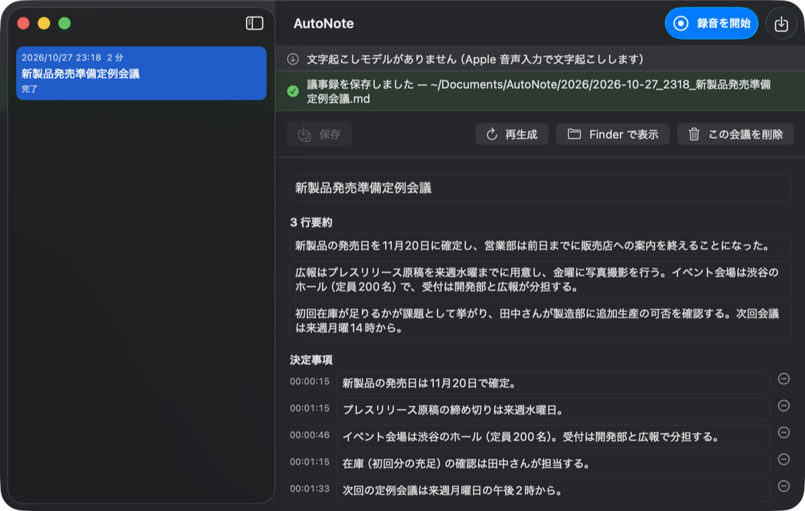

- 会議名は内容から自動で付きます（一覧の「(無題)」が置き換わります）。
- 本文には **3 行要約**、**決定事項**、**議題** などが並びます。下へスクロールすると続きが読めます。
- **Finder で表示** を押すと、保存された議事録ファイル（Markdown 形式）が Finder で選ばれた状態で開きます。ファイルには要約・決定事項・議題のほか、Next Action、ブックマーク、文字起こしの全文も入っています。
- ウィンドウを閉じていた場合は、通知「議事録ができました」が 1 通届きます。通知を押すと、この画面が開きます。メニューバーのメニューの **最新の議事録を開く** からも開けます。

これで最初の議事録の完成です。

---

## 7. 1 分未満で止めたとき

録音が 1 分未満だと、自動では文字起こしも議事録づくりもしません。試しに録っただけの短い録音で、議事録が勝手に増えないようにするためです。

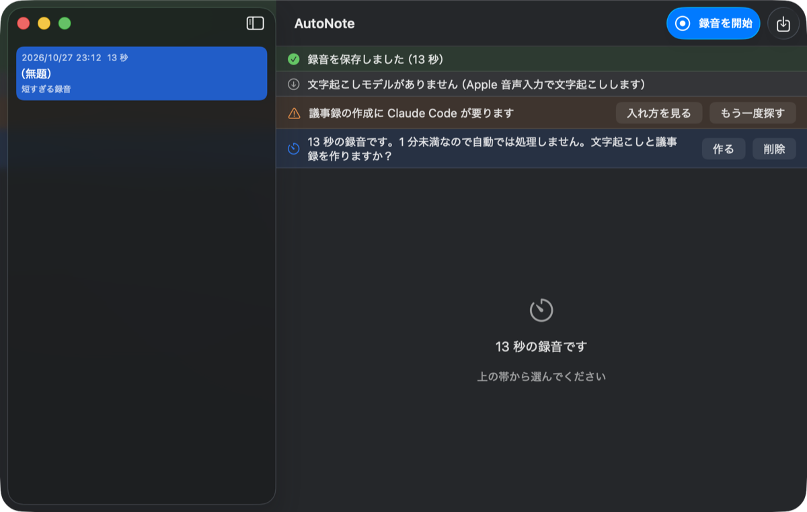

- 議事録がほしいときは **作る** を押します。そこから「5.」と同じ流れで処理が進みます。
- 要らなければ **削除** を押します。

## 8. うまくいかないとき

うまくいかなかったときは、右側の赤い帯に「何が起きたか — なぜか」と、次に押すボタンが出ます。左の一覧では、その会議の状態が「失敗」などになります。

### 音声を聞き取れませんでした

録音に声が入っていなかったか、マイクが音を拾えていなかったときに出ます。

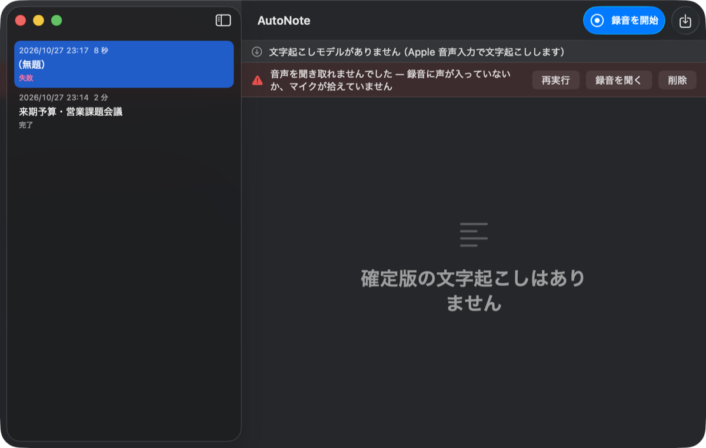

- **録音を聞く**: 録音した音声ファイルを Finder で表示します。再生して、声が入っているか確かめてください。
- **再実行**: もう一度文字起こしから処理します。文字起こしモデルのダウンロードが終わったあとなら、そちらで聞き取り直せます。
- **削除**: この録音を消します。

次の録音の前に、録音中の画面で緑のバーが話す声に合わせて伸びるか確かめてください。

### 議事録を作れませんでした — Claude Code が見つかりません

文字起こしはできたものの、Claude Code が見つからず議事録を作れなかったときに出ます。文字起こしの内容は帯の下に表示されていて、失われてはいません。

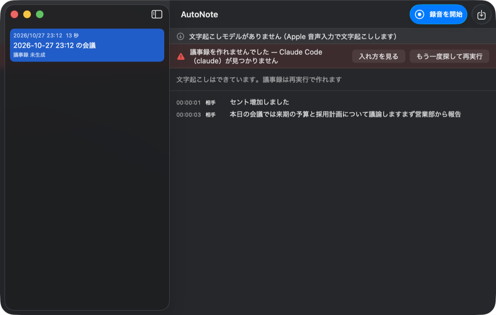

1. **入れ方を見る** を押し、手順に沿って Claude Code を入れてログインします（「2.」と同じです）。
2. **もう一度探して再実行** を押すと、Claude Code を探し直して議事録を作ります。

### 保存先が見つかりません

保存先のフォルダを消したり移動したりすると、準備カードの「保存先」の行がこの表示になります。

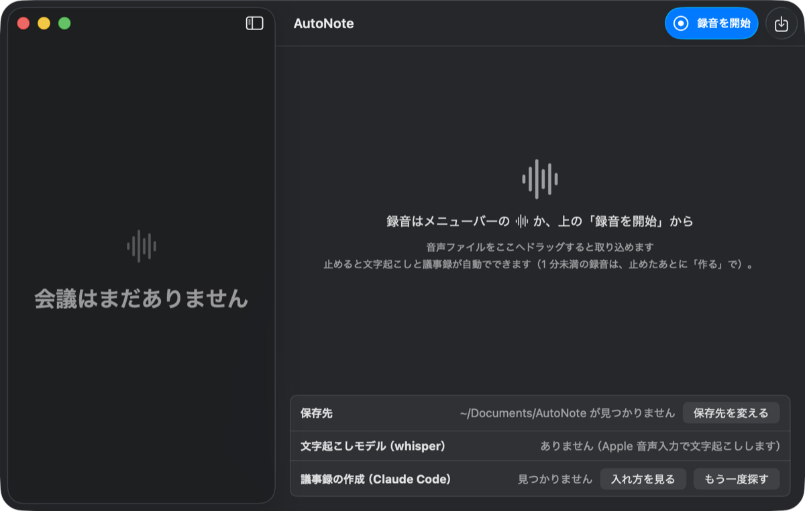

**保存先を変える** を押すと設定の「一般」タブが開くので、議事録を保存したいフォルダを選び直してください。

CLI、Automations、ショートカット、通知、ログイン時起動は [リファレンス](reference.md) を参照してください。

## 9. 対応機種と whisper モデルの目安

停止後の文字起こし（確定版）は whisper.cpp のモデルで行います。設定 →「文字起こし」→「whisper のモデル」でダウンロードと選択ができます。既定は large-v3-turbo です。録音中のライブ表示は、既定では Apple の音声認識（Intel は音声入力、Apple シリコンは SpeechTranscriber）なので、モデルの重さは停止後の処理時間と、そのあいだのメモリと CPU にだけ効きます（ライブにも whisper を選んだときは下の「ライブに whisper を選ぶとき」を参照）。

| モデル | ダウンロード | 処理中のメモリの目安（モデル + 作業領域） | 精度（日本語 CER、Intel 実測） | 向く機種 |
|---|---|---|---|---|
| base | 148 MB | 約 0.4 GB | 0.37（固有名詞が崩れやすい） | 8 GB の Intel。下書き用 |
| small | 488 MB | 約 0.9 GB | 0.28 | 8 GB の Intel / M1。速さ優先 |
| large-v3-turbo-q5_0 | 574 MB | 約 1.0 GB | 0.22 | 8 GB の M1〜M4。turbo と同じ精度で軽い |
| large-v3-turbo（既定） | 1.6 GB | 約 2.0 GB | 0.22 | 16 GB 以上、または Intel 32 GB |

- 処理時間の目安（停止後の待ち。RTF は処理時間 ÷ 録音の長さ）:

  | 機種 | モデル | RTF | 1 時間の会議 |
  |---|---|---|---|
  | Intel 4 コア（Core i7-1068NG7、Metal なし） | large-v3-turbo | 0.68〜0.85（ベンチ） | 約 40〜50 分 |
  | 同上 | large-v3-turbo-q5_0 | 1.31（実際の 14.5 分の会議。4 スレッド。同時に動いていた他のアプリの負荷を含む可能性あり） | 約 80 分 |
  | 同上 | small | 0.33〜0.45（ベンチ） | 約 20〜27 分 |
  | 同上 | base | 約 0.14 | 約 8〜9 分 |
  | Apple シリコン（M1 8 GB） | large-v3-turbo | 未実測 | 10〜15 分の見込み |
  | Apple シリコン（M1 Pro 以上、M2〜M4） | large-v3-turbo | 未実測 | 5〜10 分の見込み |

  Apple シリコンは Metal を使うので同じモデルでも数倍速い見込みです（`scripts/bench-whisper.sh` で測れます）。Intel の数値は 4 スレッドのものなので、既定の 3 スレッド（下の「CPU の使い方」）では 25〜30 % ほど長くなります。
- CPU の使い方: Metal のない Intel では、確定版の処理中は whisper が CPU を使い続けます。設定 →「文字起こし」→「確定版」の「文字起こしに使う CPU」で、使うスレッド数を選べます。既定の「自動」は物理コア数 − 1（上限 4）で、他の作業のために 1 コア空けます（物理 4 コアなら 3、8 コア以上なら 4）。増やすと速くなりますが、そのあいだ他のアプリが重くなります。
- メモリ: 窓分割で、録音の長さにかかわらず文字起こし中の作業領域は約 0.2 GB で一定です。上の表の「処理中のメモリ」はモデルの重みと whisper の内部領域を足したもので、会議アプリやブラウザと同時に動かすなら、この分の空きがあるかで選んでください。8 GB の Mac で large-v3-turbo（2 GB）を使うと、他のアプリが多いときにスワップが増えます。
- medium は large-v3-turbo より遅く精度も下なので提供していません。q5_0（量子化）は turbo と精度がほぼ同じ（CER の差 0.003 以内）で、ダウンロードは約 3 分の 1、処理中のメモリは約半分です。

### ライブに whisper を選ぶとき

設定 →「文字起こし」→「リアルタイム」では whisper のモデルも選べます。ライブの whisper は 2 スレッドで、話している途中の区間を何度も解き直すので、確定版より重くなります。Metal のない Intel では、small より大きいモデル（large-v3-turbo、large-v3-turbo-q5_0）はリアルタイムに追いつかず、表示が遅れていき、録音中ずっと CPU を約 2 コア分使います（確定版 4 スレッドで RTF 1.31 の実測からの見込み）。Intel ではライブは Apple の音声入力（既定）のままにしてください。

### 警告が出る組み合わせ

次の組み合わせを選ぶと、準備カードと設定 →「文字起こし」のエンジンの選択の下に警告が出ます（録音はそのままできます）。

| 条件 | 警告 |
|---|---|
| Intel で、確定版が large-v3-turbo か large-v3-turbo-q5_0 | 停止後の処理に録音と同じ〜1.3 倍の時間がかかり、そのあいだ CPU をほぼ使い切る。small なら約半分 |
| 物理メモリが 16 GB 未満で、確定版が large-v3-turbo | メモリが足りずスワップが増える。large-v3-turbo-q5_0 なら同じ精度でメモリは約半分 |
| Intel で、ライブが whisper の large-v3-turbo か large-v3-turbo-q5_0 | リアルタイムに追いつかない。Apple の音声入力を推奨 |

Apple シリコンでは速さの警告は出ません（Metal を使うため）。警告は、実際に使われるエンジン（選んだモデルがダウンロードされていなければ、代わりに使われるもの）で判定します。
