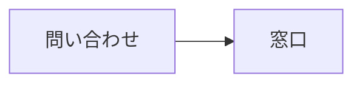

# サンプル商事 トライアル打合せ

## 出席者
担当者 A（総務）、担当者 B（情報システム）、営業担当

## 議題
### 1. いまの問い合わせ対応の困りごと
電話とメールで月 300 件ほど。半分は同じ質問。 （→ 00:07:08）

### 2. 試用の範囲
社内向けの窓口だけで 2 週間試す。 （→ 00:07:08）

## 要約
問い合わせ対応の試用を 12 月中旬から 2 週間行うことで合意した。読み込ませる資料は社内規程の PDF 3 点。

試用の後に、回答の正しさと件数の減り方を一緒に見る。

## 決定事項
- 12 月 15 日から 2 週間、社内向けの窓口で試用する （→ 01:02:03）
- 関連: [[別のノート]] と [[#要約|要約へ]] と [[#^abc|ブロック]]

## アクション
| 優先度 | 内容 | 担当 | 期限 | 出典 |
|---|---|---|---|---|
| 高 | 申込書と手順書を送る（A\|B 両方） | 営業担当 | 2026-12-05 | （→ 00:07:08） |
| 中 | 規程の PDF を共有する | 総務 | — | — |

## 質問
- [ ] 試用の後、データはどう消すか — 担当者 B （→ 01:02:03）
  → 試用の終わりに消す

## 構成図

## 文字起こし
全文は別のファイル `文字起こし/2026-12-02_1000_サンプル商事 トライアル打合せ_文字起こし.md` にあります。話者はすべて「不明」です。本文の（→ 00:07:08）は、文字起こしの `[00:07:08]` の発言を指します。

## 議事録の訳文（英語）

> 端末内の翻訳モデルで上の議事録を訳したものです。原文が正です。

**Sample Trading trial meeting**

### Agenda
#### 1. Current pain points
About 300 inquiries a month. （→ 00:07:08）

### Summary
- none

### Actions
| 優先度 | 内容 | 担当 | 期限 | 出典 |
|---|---|---|---|---|
| 高 | Send the application form | 営業担当 | 2026-12-05 | （→ 00:07:08） |
