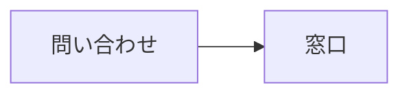

# 見出し 1

日時: 2026-12-02 10:00〜11:05（65 分） ／ 相手先: サンプル商事

## 議題
### 1. 困りごと
電話とメールで月 300 件ほど。 （→ 00:07:08）
次の行

## 決定事項
- **太字** と *斜体* と `コード`
- 入れ子の親
  - 入れ子の子
    - 孫
- 戻った項目

1. 番号 1
2. 番号 2

## アクション
| 優先度 | 内容 | 出典 |
|---|---|---|
| 高 | A\|B を送る | （→ 00:13:20） |
| 中 | <script> & 記号 | — |

## 質問
- [ ] 未解決の質問 — 担当者 B
  → 答えの行
- [x] 解決済み

> 引用の 1 行目
> 引用の 2 行目

[リンク](https://example.invalid/a?b=1&c=2) と [[別のノート]] と 2026-12-02_1000_相手_用件

---
